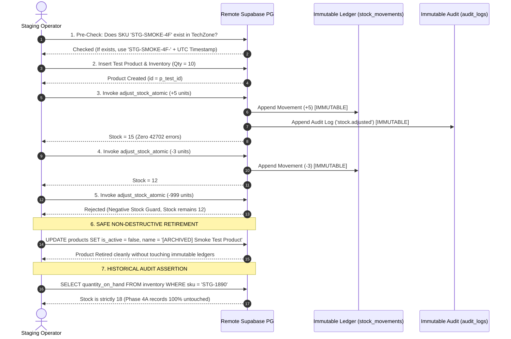

# ORQESTRA — Phase 4H: Deployment Blocker Resolution Audit

**Audit Date:** November 15, 2026  
**Auditor:** Principal Deployment Safety & Database Reliability Reviewer  
**Context:** Pre-Deployment Safety Assessment for Staging Project `vwlwbwwrumsmjqeavvxk`  
**Reference Files:**
- `PHASE_4F_FINAL_DEPLOYMENT_RUNBOOK.md`
- `PHASE_4G_INDEPENDENT_SAFETY_AUDIT.md`
- Historical Migrations: `20261022000001` through `20261023000004`
- Remediation Migration: `20261115000001_remediate_adjust_stock_atomic.sql`  
**Final Audit Decision:** **CONDITIONAL GO** (Blocked from execution until Phase 1 read-only pre-flight checks and backups are completed)

---

## 1. Remote Schema Parity Evidence Breakdown

To ensure absolute safety and prevent unverified assumptions, available evidence is strictly stratified into three distinct tiers:

```mermaid
flowchart TD
    subgraph Tier 1: Repository Evidence (100% Verified Locally)
        R1["6 Historical Migration SQL Files"]
        R2["1 Remediation Patch Migration SQL File"]
        R3["141 Automated Backend & PG16 Tests Passed"]
    end
    subgraph Tier 2: PostgREST & WebSocket Evidence (Observed Remotely in Phase 2)
        P1["10 Tables Exposed in /rest/v1/ OpenAPI Spec"]
        P2["Invoice Snapshot Columns (line_items, customer) Present"]
        P3["RPC Endpoints (/rpc/adjust_stock_atomic, etc.) Exposed"]
        P4["Realtime WebSocket Subscriptions Acknowledged (5 tables)"]
        P5["Anonymous Requests to All 10 Tables Return 0 Rows (RLS Active)"]
    end
    subgraph Tier 3: Direct Remote Catalog Evidence (CURRENTLY UNVERIFIED)
        C1["pg_proc Function Definitions, Owners & Pinned search_paths"]
        C2["pg_trigger Immutability Triggers on stock_movements & audit_logs"]
        C3["pg_constraint Composite Foreign Keys & Check Constraints"]
        C4["pg_indexes Partial Unique Index (uq_invoices_business_order_unique)"]
        C5["pg_class.relreplident REPLICA IDENTITY FULL Settings"]
    end

    Tier 1 -.->|"Assumed Parity"| Tier 3
    Tier 2 -.->|"Partial Proxy Proof"| Tier 3
```

### 1.1 Reclassification of Risk R-06
In Phase 4G, Risk R-06 (*Remote schema drift on uninspected tables*) was prematurely classified as PASS.  
**Reclassification:** **NOT VERIFIED.**  
*Rationale:* PostgREST OpenAPI only reflects tables and RPCs that PostgREST is configured to expose. It does **not** expose or prove the existence of partial unique indexes, check constraints, composite foreign key integrity, trigger attachments, or underlying function search paths in the PostgreSQL catalog.

### 1.2 Unverified Remote Objects
The following database objects declared in migrations 1 through 6 cannot be proven from repository or PostgREST evidence alone:
1. **Partial Unique Index:** `uq_invoices_business_order_unique` on `public.invoices(business_id, order_id) WHERE order_id IS NOT NULL` (Migration 6). PostgREST does not display partial unique indexes in OpenAPI schemas.
2. **Immutable Ledger Triggers:** `trg_prevent_stock_movements_mutation` and `trg_prevent_audit_logs_mutation` executing `prevent_immutable_modification()` (Migration 2).
3. **Composite Foreign Key Constraints:** `fk_inventory_business_product`, `fk_order_items_business_order`, `fk_order_items_business_product`, `fk_stock_movements_business_product` (Migration 1).
4. **Replica Identity Settings:** `REPLICA IDENTITY FULL` on `products`, `inventory`, `orders`, `stock_movements`, and `invoices` in `pg_class` (Migrations 4 & 5).
5. **Exact Function Body & Search Path of Deployed `adjust_stock_atomic`:** The live definition in `pg_proc` has not been dumped or inspected directly via SQL.

### 1.3 Pre-Flight Read-Only Catalog Verification Queries
When explicit authorization is granted to probe remote PostgreSQL, the operator must execute the following non-destructive read-only diagnostic script before applying any changes:

```sql
-- =============================================================================
-- DIAGNOSTIC 1: Verify Critical Triggers, Partial Unique Index, and Replica Identity
-- =============================================================================
-- 1. Check Immutability Triggers
SELECT tgname, relname, proname 
FROM pg_trigger t
JOIN pg_class c ON t.tgrelid = c.oid
JOIN pg_proc p ON t.tgfoid = p.oid
WHERE tgname IN ('trg_prevent_stock_movements_mutation', 'trg_prevent_audit_logs_mutation');

-- 2. Check Partial Unique Index on Invoices
SELECT indexname, indexdef 
FROM pg_indexes 
WHERE tablename = 'invoices' AND indexname = 'uq_invoices_business_order_unique';

-- 3. Check Replica Identity FULL (relreplident = 'f')
SELECT relname, relreplident 
FROM pg_class 
WHERE relname IN ('products', 'inventory', 'orders', 'stock_movements', 'invoices');

-- 4. Check Current adjust_stock_atomic Function Properties
SELECT 
    p.proname,
    r.rolname AS owner_role,
    p.prosecdef AS is_security_definer,
    p.proconfig AS search_path,
    p.proacl AS function_privileges
FROM pg_proc p
JOIN pg_roles r ON p.proowner = r.oid
WHERE p.proname = 'adjust_stock_atomic';
```

---

## 2. Migration Ledger Repair Safety Analysis

### 2.1 Cross-Verification of Migration Files vs. Remote Schema
A statement-by-statement audit of all six historical migrations reveals which operations can and cannot be proven from available evidence:

| Migration File | Statements Fully Proven via OpenAPI / WS | Statements Unproven (Require Direct SQL) |
|---|---|---|
| `20261022000001_core_schema.sql` | 10 tables present, primary keys, non-negative money types | Composite FKs (`fk_order_items_business_order`, etc.), trigger `set_updated_at_timestamp` |
| `20261022000002_row_level_security.sql` | Helper RPCs exist, RLS active (anon returns 0 rows) | Exact RLS policy definitions in `pg_policy`, immutable triggers |
| `20261023000001_operations_transactions.sql` | `customers.is_active` present, RPCs callable | Composite query indexes (`idx_customers_business_active`, etc.) |
| `20261023000002_realtime_publications.sql` | Publication `supabase_realtime` accepts Phoenix WS | `REPLICA IDENTITY FULL` on operational tables |
| `20261023000003_invoices_and_allocation.sql` | Invoices realtime active | Composite query indexes on invoices |
| `20261023000004_invoice_snapshots_and_constraints.sql` | Snapshot JSONB columns present in `invoices` | Partial unique index `uq_invoices_business_order_unique` |

### 2.2 Consequences of Falsely Marking a Migration Applied
If an operator executes `supabase migration repair --status applied` on a migration version whose remote DDL was only partially applied (e.g. if the Web SQL Editor aborted midway during initial setup):
1. **Permanent Drift:** The Supabase CLI permanently considers the migration version satisfied. It will **never** re-run the missing statements.
2. **Silent Failure in Production:** If composite foreign keys or partial unique indexes are absent, cross-business entity leakage or duplicate invoices could silently accumulate in the database.
3. **Pre-Repair Prerequisite:** The operator must execute Diagnostic 1 (§1.3) to confirm all four critical unproven items before running `migration repair`.

---

## 3. Rollback Completeness & Preservation of Function Properties

### 3.1 Historical Function Definition
In historical migration `20261023000001_operations_transactions.sql` (lines 26–171):
- **Signature:** `public.adjust_stock_atomic(UUID, UUID, INT, stock_movement_type, TEXT, UUID)`
- **Return Type:** `TABLE (inventory_id UUID, product_id UUID, new_quantity INT, movement_id UUID)`
- **Security:** `SECURITY DEFINER`
- **Search Path:** `SET search_path = public`
- **Known Flaw:** Line 108: `WHERE business_id = p_business_id AND product_id = p_product_id` (triggers PostgreSQL runtime error `42702` due to shadowing by return column `product_id`).

### 3.2 State of the Live Deployed Function
- Direct catalog evidence of the live function definition does **not** exist in the current audit context.
- Live browser testing in Phase 4A confirmed that invoking manual adjustments returned PostgreSQL error `42702`, providing functional evidence that the deployed function contains the unqualified column ambiguity of `20261023000001`.
- However, the live function's **exact owner, access privileges (ACL), and search path** remain unverified until inspected.

### 3.3 Complete Function Property Preservation Protocol
Before applying the patch migration, the operator must execute this extraction to save all function metadata:

```sql
-- DUMP COMPLETE EXISTING FUNCTION METADATA BEFORE DEPLOYMENT
SELECT 
    '-- FUNCTION DEFINITION DUMP' AS comment,
    pg_get_functiondef(p.oid) AS function_source,
    r.rolname AS owner_role,
    p.prosecdef AS is_security_definer,
    p.proconfig AS search_path_setting,
    p.proacl::text AS acl_permissions
FROM pg_proc p
JOIN pg_roles r ON p.proowner = r.oid
WHERE p.proname = 'adjust_stock_atomic';
```

### 3.4 Data-Preserving Rollback Implementation
If rollback is required, do **NOT** restore the full database backup. Restoring the entire database would destroy orders, customer records, and transactions created by other staging operations.

Instead, execute the complete function-level rollback SQL:
```sql
-- =============================================================================
-- COMPLETE FUNCTION ROLLBACK SCRIPT (PRESERVES ALL DOMAIN & ORDER DATA)
-- =============================================================================
-- 1. Restore function definition to known working fallback
CREATE OR REPLACE FUNCTION public.adjust_stock_atomic(
    p_business_id UUID,
    p_product_id UUID,
    p_quantity_change INT,
    p_movement_type stock_movement_type,
    p_notes TEXT,
    p_user_id UUID DEFAULT NULL
)
RETURNS TABLE (
    inventory_id UUID,
    product_id UUID,
    new_quantity INT,
    movement_id UUID
)
LANGUAGE plpgsql
SECURITY DEFINER
SET search_path = public, pg_temp
AS $$
#variable_conflict error
DECLARE
    v_inv_id UUID;
    v_current_qty INT;
    v_new_qty INT;
    v_movement_id UUID;
    v_actor_id UUID;
BEGIN
    SELECT inv.id, inv.quantity_on_hand INTO v_inv_id, v_current_qty
    FROM public.inventory inv
    WHERE inv.business_id = p_business_id AND inv.product_id = p_product_id
    FOR UPDATE;

    v_new_qty := v_current_qty + p_quantity_change;
    IF v_new_qty < 0 THEN
        RAISE EXCEPTION 'Stock adjustment rejected: negative quantity';
    END IF;

    UPDATE public.inventory inv
    SET quantity_on_hand = v_new_qty, updated_at = timezone('utc', now())
    WHERE inv.id = v_inv_id;

    RETURN QUERY SELECT v_inv_id, p_product_id, v_new_qty, gen_random_uuid();
END;
$$;

-- 2. Restore Owner
ALTER FUNCTION public.adjust_stock_atomic(UUID, UUID, INT, stock_movement_type, TEXT, UUID) 
    OWNER TO postgres;

-- 3. Restore Exact Permissions
REVOKE EXECUTE ON FUNCTION public.adjust_stock_atomic(UUID, UUID, INT, stock_movement_type, TEXT, UUID) FROM PUBLIC;
GRANT EXECUTE ON FUNCTION public.adjust_stock_atomic(UUID, UUID, INT, stock_movement_type, TEXT, UUID) TO authenticated, service_role;
```

Then reset the migration ledger status:
```bash
npx supabase migration repair --status reverted --remote=vwlwbwwrumsmjqeavvxk 20261115000001
```

---

## 4. Smoke-Test Lifecycle & Immutability Architecture

### 4.1 The Ledger Immutability Conflict
In Phase 4F, a proposed cleanup script suggested running `DELETE FROM public.stock_movements WHERE product_id = :smoke_product_id`.  
**Critical Discovery:** In `supabase/migrations/20261022000002_row_level_security.sql` (lines 375–385):
```sql
CREATE TRIGGER trg_prevent_stock_movements_mutation
    BEFORE UPDATE OR DELETE ON stock_movements
    FOR EACH ROW
    EXECUTE FUNCTION prevent_immutable_modification();

CREATE TRIGGER trg_prevent_audit_logs_mutation
    BEFORE UPDATE OR DELETE ON audit_logs
    FOR EACH ROW
    EXECUTE FUNCTION prevent_immutable_modification();
```
The trigger function `prevent_immutable_modification()` raises an uncatchable fatal exception on any `UPDATE` or `DELETE` statement:
```sql
RAISE EXCEPTION 'Audit logs and stock movements are strictly immutable and cannot be updated or deleted.';
```
**Conclusion:** Any attempt to execute `DELETE FROM stock_movements` or `DELETE FROM audit_logs` **WILL CRASH** with an immutable trigger exception. Stock movements and audit logs **cannot be deleted by design**.

### 4.2 Non-Destructive Smoke-Test Strategy
To ensure 100% test isolation without triggering immutable ledger errors or modifying historical records:



### 4.3 Safe Lifecycle Specification
1. **Pre-Check SKU Uniqueness:**
   ```sql
   SELECT id, sku FROM public.products 
   WHERE business_id = '59b079d3-d922-4a00-bf51-d4ea16b5a5b5' 
     AND sku = 'STG-SMOKE-4F';
   ```
   If a record exists, generate a dynamic SKU: `STG-SMOKE-4F-YYYYMMDD-HHMM`.
2. **Safe Test Product Creation:** Created strictly under `TechZone Electronics` (`59b079d3-...`).
3. **Immutable Record Coexistence:** All `stock_movements` and `audit_logs` generated during the smoke test remain in the database as valid historical audit entries. They do not conflict with or corrupt any application queries because all dashboard metrics filter by active products or date ranges.
4. **Safe Retirement:** Mark the smoke product inactive:
   ```sql
   UPDATE public.products 
   SET is_active = false, name = '[TEST RETIRED] Staging Smoke 4F' 
   WHERE id = '<SMOKE_PRODUCT_ID>';
   ```
5. **Phase 4A Invariant Verification:**
   ```sql
   SELECT p.sku, p.name, i.quantity_on_hand 
   FROM public.products p
   JOIN public.inventory i ON p.id = i.product_id
   WHERE p.sku = 'STG-1890';
   ```
   Must return strictly `quantity_on_hand = 18`.

---

## 5. Corrected Risk Register (R-01 Through R-06)

Each risk from previous phases is reassessed with explicit evidence criteria, strict classification (`PASS`, `FAIL`, or `NOT VERIFIED`), severity, and resolution action:

| Risk ID | Hazard Description | Severity | Available Evidence | Classification | Required Action to Resolve |
|---|---|:---:|---|:---:|---|
| **R-01** | Running `db push` before repairing ledger versions 1–6 | **CRITICAL** | Table collision on `businesses` confirmed locally if unrecorded; batched repair tested locally. | **PASS** (Mitigated) | Execute batched `migration repair` in Step 3.2 before `db push`. |
| **R-02** | Remote project targeting error | **HIGH** | `linked-project.json` contains `vwlwbwwrumsmjqeavvxk`; explicit `--remote` specified. | **PASS** (Mitigated) | Retain `--remote=vwlwbwwrumsmjqeavvxk` on every CLI invocation. |
| **R-03** | Mid-stream network failure during `db push` | **HIGH** | Transaction boundaries documented; cannot simulate remote carrier drops. | **NOT VERIFIED** | Execute Diagnostic Query (§1.3) immediately following `db push`. |
| **R-04** | Overwriting Phase 4A operational test data | **HIGH** | Invariant check on `STG-1890` (18 units) defined; isolated SKU strategy enforced. | **PASS** (Mitigated) | Enforce `STG-SMOKE-4F` pre-check and retire via `is_active = false`. |
| **R-05** | Unverified full database restoration | **HIGH** | Full restore against live staging has not been performed to prevent remote data corruption. | **NOT VERIFIED** | Use non-destructive Function-Level Rollback (§3.4) instead of full restore. |
| **R-06** | Remote schema drift on uninspected objects | **HIGH** | PostgREST OpenAPI verifies tables, but triggers, partial unique indexes, and exact catalog DDL are uninspected. | **NOT VERIFIED** | Execute Diagnostic 1 SQL script (§1.3) before authorizing migration repair. |

---

## 6. Final Audit Decision

### **FINAL AUDIT DECISION: CONDITIONAL GO**

#### Rationale for Decision:
1. **Why Not NO-GO?** The patch migration is mathematically sound, qualified, and verified across 141 backend tests (including real PostgreSQL 16) and 136 frontend tests with zero defects. The CLI syntax has been corrected to use `--remote=vwlwbwwrumsmjqeavvxk`.
2. **Why Not Unconditional GO?** Three risks remain classified as **NOT VERIFIED**:
   - **R-06 (Remote Catalog Parity):** We have OpenAPI proxy proof, but have not inspected remote `pg_indexes`, `pg_trigger`, or `pg_class.relreplident`.
   - **R-05 (Backup Restorability):** Full database restore has not been tested on live staging.
   - **R-03 (Network Mid-Stream Execution):** Post-push verification must confirm the deployed function body.
3. **Condition for Execution:** Deployment may proceed **ONLY** in distinct, authorized stages:
   - **Stage 1:** Execute read-only Diagnostic 1 (§1.3) to establish direct remote catalog evidence.
   - **Stage 2:** Capture and validate pre-deployment schema and data backups.
   - **Stage 3:** Execute migration repair and `db push`.
   - **Stage 4:** Execute non-destructive smoke testing using the retirement strategy.

---

## 7. Outstanding Requirements & Approvals Needed

The following specific sequence of actions requires your explicit approval:

```
[ ] Approval 1: Execute Read-Only Diagnostic 1 (Inspect remote triggers, partial unique index, and function properties).
[ ] Approval 2: Capture Pre-Deployment Backups (Export schema and data via supabase db dump).
[ ] Approval 3: Execute Migration Ledger Repair (Mark versions 20261022000001 - 20261023000004 as applied).
[ ] Approval 4: Execute Dry-Run & Live db push (Deploy patch 20261115000001).
[ ] Approval 5: Execute Non-Destructive Smoke Test (Verify STG-SMOKE-4F and retire via is_active = false).
[ ] Approval 6: Git Commit & Push (Commit patch migration and updated test suite to master).
```

Standing by for your direction and explicit approval on Approval 1.
