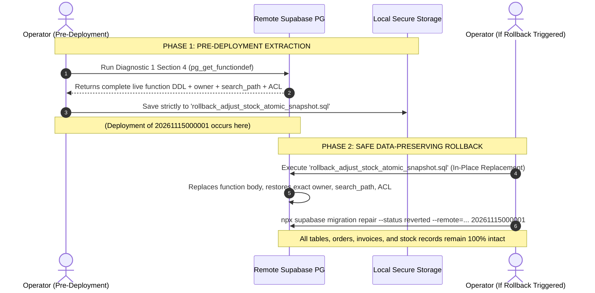

# ORQESTRA — Phase 4I: Final Diagnostic SQL & Rollback Safety Correction

**Audit Date:** November 15, 2026  
**Auditor:** Independent Principal Security & Database Reliability Reviewer  
**Context:** Final Pre-Deployment Catalog Inspection & Safe Rollback Specification for Project `vwlwbwwrumsmjqeavvxk`  
**Reference Files:**
- `PHASE_4H_DEPLOYMENT_BLOCKER_RESOLUTION.md`
- `PHASE_4G_INDEPENDENT_SAFETY_AUDIT.md`
- `PHASE_4F_FINAL_DEPLOYMENT_RUNBOOK.md`
- Historical Migrations: `20261022000001` through `20261023000004`
- Remediation Migration: `20261115000001_remediate_adjust_stock_atomic.sql`  
**Final Audit Recommendation:** **CONDITIONAL GO** (Strictly blocked pending completion of Diagnostic 1 catalog inspection and pre-deployment backups)

---

## 1. Complete Read-Only SQL Diagnostic (Diagnostic 1)

This comprehensive diagnostic script must be executed via the Supabase Web SQL Editor (or read-only database connection) prior to approving migration ledger repair or deployment.

### 1.1 Design & Safety Guarantees
- **Strictly Read-Only:** Contains only `SELECT` queries against system catalogs (`pg_proc`, `pg_trigger`, `pg_constraint`, `pg_index`, `pg_policy`, `pg_class`, `pg_namespace`, `pg_roles`). Zero DDL or DML.
- **Zero Secret or Customer Exposure:** Does not select from domain tables (`customers`, `orders`, `businesses`, `audit_logs`). Only schema metadata is queried.
- **Permissions-Aware Catalog Probing:** Section 0 verifies that the connected session possesses `USAGE` on the `public` schema and can read system catalogs. If an object query returns empty, Section 0 prevents falsely assuming the object is missing when the session simply lacked visibility.

```sql
-- =============================================================================
-- ORQESTRA STAGING DIAGNOSTIC 1: COMPLETE READ-ONLY CATALOG INSPECTION
-- Project Reference: vwlwbwwrumsmjqeavvxk
-- Target Schema: public
-- Mode: Strictly Read-Only (Non-destructive)
-- =============================================================================

-- -----------------------------------------------------------------------------
-- SECTION 0: SESSION VISIBILITY & CATALOG READ PERMISSIONS CHECK
-- -----------------------------------------------------------------------------
SELECT 
    current_database() AS database_name,
    current_user AS connected_user,
    session_user AS current_session_user,
    has_schema_privilege('public', 'USAGE') AS has_public_usage_privilege,
    has_table_privilege('pg_proc', 'SELECT') AS can_read_pg_proc,
    has_table_privilege('pg_trigger', 'SELECT') AS can_read_pg_trigger,
    has_table_privilege('pg_constraint', 'SELECT') AS can_read_pg_constraint,
    has_table_privilege('pg_policy', 'SELECT') AS can_read_pg_policy;

-- -----------------------------------------------------------------------------
-- SECTION 1: IMMUTABLE LEDGER TRIGGERS & TRIGGER FUNCTION DEFINITIONS
-- Verifies that stock_movements and audit_logs are protected by active immutability triggers.
-- -----------------------------------------------------------------------------
SELECT 
    c.relname AS table_name,
    t.tgname AS trigger_name,
    CASE t.tgenabled 
        WHEN 'O' THEN 'enabled (origin/local)'
        WHEN 'D' THEN 'DISABLED'
        WHEN 'A' THEN 'always enabled'
        WHEN 'R' THEN 'replica only'
        ELSE t.tgenabled::text
    END AS trigger_enabled_status,
    p.proname AS trigger_function_name,
    pg_get_functiondef(p.oid) AS trigger_function_definition
FROM pg_trigger t
JOIN pg_class c ON t.tgrelid = c.oid
JOIN pg_namespace n ON c.relnamespace = n.oid
JOIN pg_proc p ON t.tgfoid = p.oid
WHERE n.nspname = 'public' 
  AND c.relname IN ('stock_movements', 'audit_logs')
  AND NOT t.tgisinternal
ORDER BY c.relname, t.tgname;

-- -----------------------------------------------------------------------------
-- SECTION 2: PARTIAL UNIQUE INDEX ON INVOICES (MIGRATION 6 AUDIT)
-- Verifies existence, index predicate, and validity of uq_invoices_business_order_unique.
-- -----------------------------------------------------------------------------
SELECT 
    c.relname AS table_name,
    i.relname AS index_name,
    ix.indisunique AS is_unique_index,
    ix.indisvalid AS is_valid_index,
    pg_get_expr(ix.indpred, ix.indrelid) AS partial_index_predicate,
    pg_get_indexdef(ix.indexrelid) AS full_index_definition
FROM pg_index ix
JOIN pg_class c ON ix.indrelid = c.oid
JOIN pg_class i ON ix.indexrelid = i.oid
JOIN pg_namespace n ON c.relnamespace = n.oid
WHERE n.nspname = 'public' 
  AND c.relname = 'invoices'
  AND i.relname = 'uq_invoices_business_order_unique';

-- -----------------------------------------------------------------------------
-- SECTION 3: REPLICA IDENTITY FULL ON OPERATIONAL TABLES (MIGRATIONS 4 & 5)
-- Verifies that operational tables send complete row state on UPDATE/DELETE to Realtime CDC.
-- -----------------------------------------------------------------------------
SELECT 
    c.relname AS table_name,
    CASE c.relreplident
        WHEN 'd' THEN 'default (primary key only)'
        WHEN 'n' THEN 'nothing'
        WHEN 'f' THEN 'FULL (REPLICA IDENTITY FULL - Compliant)'
        WHEN 'i' THEN 'custom index'
        ELSE c.relreplident::text
    END AS replica_identity_status,
    (c.relreplident = 'f') AS is_compliant_full_replica
FROM pg_class c
JOIN pg_namespace n ON c.relnamespace = n.oid
WHERE n.nspname = 'public'
  AND c.relname IN ('products', 'inventory', 'orders', 'stock_movements', 'invoices')
ORDER BY c.relname;

-- -----------------------------------------------------------------------------
-- SECTION 4: EXACT DEPLOYED adjust_stock_atomic FUNCTION METADATA & SOURCE
-- Captures function signature, return type, owner, SECURITY DEFINER mode, search_path,
-- ACLs, effective privileges, and complete source text for pre-patch preservation.
-- -----------------------------------------------------------------------------
SELECT 
    p.proname AS function_name,
    pg_get_function_identity_arguments(p.oid) AS argument_signature,
    pg_get_function_result(p.oid) AS return_signature,
    r.rolname AS owner_role,
    p.prosecdef AS is_security_definer,
    p.proconfig AS search_path_configuration,
    p.proacl::text AS raw_access_control_list,
    has_function_privilege('anon', p.oid, 'EXECUTE') AS anon_can_execute,
    has_function_privilege('authenticated', p.oid, 'EXECUTE') AS authenticated_can_execute,
    has_function_privilege('service_role', p.oid, 'EXECUTE') AS service_role_can_execute,
    pg_get_functiondef(p.oid) AS complete_function_source
FROM pg_proc p
JOIN pg_namespace n ON p.pronamespace = n.oid
JOIN pg_roles r ON p.proowner = r.oid
WHERE n.nspname = 'public' 
  AND p.proname = 'adjust_stock_atomic';

-- -----------------------------------------------------------------------------
-- SECTION 5: COMPOSITE FOREIGN KEY INTEGRITY & VALIDATION STATUS (MIGRATION 1)
-- Verifies that cross-business foreign keys exist and are marked convalidated = true.
-- -----------------------------------------------------------------------------
SELECT 
    c.conname AS foreign_key_name,
    rel.relname AS source_table,
    frel.relname AS target_table,
    c.convalidated AS is_validated,
    pg_get_constraintdef(c.oid) AS constraint_definition
FROM pg_constraint c
JOIN pg_class rel ON c.conrelid = rel.oid
JOIN pg_class frel ON c.confrelid = frel.oid
JOIN pg_namespace n ON rel.relnamespace = n.oid
WHERE n.nspname = 'public' 
  AND c.contype = 'f'
  AND c.conname IN (
      'fk_inventory_business_product',
      'fk_order_items_business_order',
      'fk_order_items_business_product',
      'fk_stock_movements_business_product'
  )
ORDER BY rel.relname, c.conname;

-- -----------------------------------------------------------------------------
-- SECTION 6: ROW LEVEL SECURITY POLICIES ON CRITICAL BUSINESS TABLES (MIGRATION 2)
-- Verifies RLS is enabled and inspects USING and WITH CHECK policy expressions.
-- -----------------------------------------------------------------------------
SELECT 
    c.relname AS table_name,
    c.relrowsecurity AS rls_enabled,
    c.relforcerowsecurity AS rls_enforced_for_table_owner,
    pol.polname AS policy_name,
    CASE pol.polcmd
        WHEN 'r' THEN 'SELECT'
        WHEN 'a' THEN 'INSERT'
        WHEN 'w' THEN 'UPDATE'
        WHEN 'd' THEN 'DELETE'
        WHEN '*' THEN 'ALL'
    END AS policy_command,
    ARRAY(SELECT rolname FROM pg_roles WHERE oid = ANY(pol.polroles)) AS target_roles,
    pg_get_expr(pol.polqual, pol.polrelid) AS using_expression,
    pg_get_expr(pol.polwithcheck, pol.polrelid) AS with_check_expression
FROM pg_class c
JOIN pg_namespace n ON c.relnamespace = n.oid
LEFT JOIN pg_policy pol ON c.oid = pol.polrelid
WHERE n.nspname = 'public'
  AND c.relname IN ('businesses', 'business_members', 'products', 'inventory', 'orders', 'order_items', 'invoices', 'stock_movements', 'audit_logs')
ORDER BY c.relname, pol.polname;

-- -----------------------------------------------------------------------------
-- SECTION 7: CORE HELPER & OPERATIONAL STORED PROCEDURES
-- Verifies the presence, security mode, search_path, and execution permissions
-- of all helper and operational RPCs declared across migrations 2 through 6.
-- -----------------------------------------------------------------------------
SELECT 
    p.proname AS function_name,
    pg_get_function_identity_arguments(p.oid) AS argument_signature,
    pg_get_function_result(p.oid) AS return_signature,
    r.rolname AS owner_role,
    p.prosecdef AS is_security_definer,
    p.proconfig AS search_path,
    has_function_privilege('authenticated', p.oid, 'EXECUTE') AS authenticated_can_execute,
    has_function_privilege('anon', p.oid, 'EXECUTE') AS anon_can_execute
FROM pg_proc p
JOIN pg_namespace n ON p.pronamespace = n.oid
JOIN pg_roles r ON p.proowner = r.oid
WHERE n.nspname = 'public'
  AND p.proname IN (
      'get_auth_user_id',
      'get_business_member_role',
      'has_business_role',
      'handle_new_business',
      'prevent_immutable_modification',
      'approve_order_atomic',
      'cancel_order_atomic',
      'allocate_invoice_atomic'
  )
ORDER BY p.proname;
```

---

## 2. Corrected Function-Level Rollback Strategy

> [!CAUTION]
> **Defect in Phase 4H Rollback Corrected:** The rollback script previously drafted in Phase 4H §3.4 was a simplified stub that generated synthetic movement IDs and omitted actor identity validation, stock movement ledger writes, and audit trail logging. That script has been completely rejected and replaced.

### 2.1 The Two-Phase Rollback Strategy

A truly safe, data-preserving rollback cannot rely on a pre-assumed function body. It must follow a strict two-phase protocol:



### 2.2 Phase 1: Pre-Deployment Extraction Requirement
Before executing `supabase db push`, the operator must copy the `complete_function_source` from Section 4 of Diagnostic 1 and save it to `rollback_adjust_stock_atomic_snapshot.sql`, appending:
```sql
-- Append exact owner and ACL restoration commands
ALTER FUNCTION public.adjust_stock_atomic(UUID, UUID, INT, stock_movement_type, TEXT, UUID) 
    OWNER TO <OWNER_ROLE_RECORDED_IN_SECTION_4>;

REVOKE EXECUTE ON FUNCTION public.adjust_stock_atomic(UUID, UUID, INT, stock_movement_type, TEXT, UUID) FROM PUBLIC;
GRANT EXECUTE ON FUNCTION public.adjust_stock_atomic(UUID, UUID, INT, stock_movement_type, TEXT, UUID) TO authenticated, service_role;
```

### 2.3 Verified Historical Baseline Rollback (If Deployed State Matches Migration 3)
If Diagnostic 1 confirms that the deployed function matches historical migration `20261023000001_operations_transactions.sql`, the exact full business logic rollback script is:

```sql
-- =============================================================================
-- AUTHENTIC HISTORICAL ROLLBACK: adjust_stock_atomic
-- Restores complete business logic, actor authentication, and immutable ledger writes.
-- Does NOT delete or modify existing table data.
-- =============================================================================
CREATE OR REPLACE FUNCTION public.adjust_stock_atomic(
    p_business_id UUID,
    p_product_id UUID,
    p_quantity_change INT,
    p_movement_type stock_movement_type,
    p_notes TEXT,
    p_user_id UUID DEFAULT NULL
)
RETURNS TABLE (
    inventory_id UUID,
    product_id UUID,
    new_quantity INT,
    movement_id UUID
)
LANGUAGE plpgsql
SECURITY DEFINER
SET search_path = public
AS $$
DECLARE
    v_caller_role TEXT;
    v_auth_uid UUID;
    v_actor_id UUID;
    v_inv_id UUID;
    v_current_qty INT;
    v_new_qty INT;
    v_movement_id UUID;
BEGIN
    -- 1. Input parameter validation
    IF p_business_id IS NULL THEN
        RAISE EXCEPTION 'Business ID is required';
    END IF;
    IF p_product_id IS NULL THEN
        RAISE EXCEPTION 'Product ID is required';
    END IF;
    IF p_quantity_change IS NULL OR p_quantity_change = 0 THEN
        RAISE EXCEPTION 'Quantity change must be non-zero';
    END IF;
    IF p_notes IS NULL OR length(trim(p_notes)) < 3 THEN
        RAISE EXCEPTION 'A mandatory audit reason (minimum 3 characters) is required';
    END IF;
    IF p_movement_type IS NULL THEN
        RAISE EXCEPTION 'Movement type is required';
    END IF;

    -- 2. Authenticated caller and actor resolution
    v_caller_role := coalesce(current_setting('request.jwt.claim.role', true), auth.role()::text, '');
    v_auth_uid := public.get_auth_user_id();

    IF v_caller_role = 'service_role' THEN
        IF p_user_id IS NULL THEN
            RAISE EXCEPTION 'Actor ID (p_user_id) is required for service_role invocation';
        END IF;
        v_actor_id := p_user_id;
    ELSE
        IF v_auth_uid IS NULL THEN
            RAISE EXCEPTION 'Unauthenticated caller cannot execute stock adjustments';
        END IF;
        IF p_user_id IS NOT NULL AND p_user_id != v_auth_uid THEN
            RAISE EXCEPTION 'Actor identity mismatch: caller % cannot act as user %', v_auth_uid, p_user_id;
        END IF;
        v_actor_id := v_auth_uid;
    END IF;

    -- 3. Authorization check
    IF NOT public.has_business_role(p_business_id, v_actor_id, 'admin') THEN
        RAISE EXCEPTION 'Access denied: user % does not have active admin or owner role in business %', v_actor_id, p_business_id;
    END IF;

    -- 4. Verify product belongs to business
    IF NOT EXISTS (
        SELECT 1 FROM products
        WHERE id = p_product_id AND business_id = p_business_id
    ) THEN
        RAISE EXCEPTION 'Product % does not belong to business %', p_product_id, p_business_id;
    END IF;

    -- 5. Lock inventory row FOR UPDATE
    SELECT id, quantity_on_hand
    INTO v_inv_id, v_current_qty
    FROM inventory
    WHERE business_id = p_business_id AND product_id = p_product_id
    FOR UPDATE;

    IF v_inv_id IS NULL THEN
        RAISE EXCEPTION 'Inventory record not found for product % in business %', p_product_id, p_business_id;
    END IF;

    -- 6. Calculate and validate new quantity
    v_new_qty := v_current_qty + p_quantity_change;
    IF v_new_qty < 0 THEN
        RAISE EXCEPTION 'Stock adjustment rejected: would result in negative quantity (%) from current (%)', v_new_qty, v_current_qty;
    END IF;

    -- 7. Update inventory
    UPDATE inventory
    SET quantity_on_hand = v_new_qty, updated_at = timezone('utc', now())
    WHERE id = v_inv_id;

    -- 8. Authentic immutable stock movement insertion
    INSERT INTO stock_movements (
        business_id,
        product_id,
        quantity_change,
        movement_type,
        notes,
        created_by,
        created_at
    )
    VALUES (
        p_business_id,
        p_product_id,
        p_quantity_change,
        p_movement_type,
        trim(p_notes),
        v_actor_id,
        timezone('utc', now())
    )
    RETURNING id INTO v_movement_id;

    -- 9. Authentic immutable audit log insertion
    INSERT INTO audit_logs (
        business_id,
        user_id,
        action,
        entity_type,
        entity_id,
        old_values,
        new_values,
        created_at
    )
    VALUES (
        p_business_id,
        v_actor_id,
        'stock.adjusted',
        'inventory',
        v_inv_id,
        jsonb_build_object('quantity_on_hand', v_current_qty),
        jsonb_build_object('quantity_on_hand', v_new_qty, 'quantity_change', p_quantity_change, 'movement_id', v_movement_id),
        timezone('utc', now())
    );

    RETURN QUERY SELECT v_inv_id, p_product_id, v_new_qty, v_movement_id;
END;
$$;

-- Restore Owner and ACL
ALTER FUNCTION public.adjust_stock_atomic(UUID, UUID, INT, stock_movement_type, TEXT, UUID) 
    OWNER TO postgres;

REVOKE EXECUTE ON FUNCTION public.adjust_stock_atomic(UUID, UUID, INT, stock_movement_type, TEXT, UUID) FROM PUBLIC;
GRANT EXECUTE ON FUNCTION public.adjust_stock_atomic(UUID, UUID, INT, stock_movement_type, TEXT, UUID) TO authenticated, service_role;
```

### 2.4 Explicit Rollback Completeness Disclosure
> [!IMPORTANT]
> **Rollback Readiness Condition:** If Section 4 of Diagnostic 1 cannot be executed prior to deployment to capture the exact live source text and permissions, a **fully verified rollback script cannot be declared ready**, because any unrecorded historical hotfix in the remote database would be overwritten during rollback.

---

## 3. Smoke-Test Safety & Baseline Verification Protocol

### 3.1 Verification of Phase 4A Baseline Records (No Assumptions)
The runbook must not assume that product `STG-1890` currently has 18 units. Before initiating any test, the operator must query and record the live baseline:

```sql
-- RECORD LIVE BASELINE BEFORE TESTING
SELECT 
    p.id AS stg_product_id,
    p.sku,
    p.name,
    i.id AS stg_inventory_id,
    i.quantity_on_hand AS baseline_quantity_on_hand
FROM public.products p
JOIN public.inventory i ON p.id = i.product_id
WHERE p.sku = 'STG-1890';
```
- **Operator Action:** Record observed `baseline_quantity_on_hand` as $Q_{\text{baseline}}$.
- **Post-Test Invariant:** After all smoke tests conclude, re-execute the query and assert `quantity_on_hand == Q_{\text{baseline}}`.

### 3.2 Dynamic SKU Uniqueness Pre-Check
```sql
SELECT id, sku FROM public.products 
WHERE business_id = '59b079d3-d922-4a00-bf51-d4ea16b5a5b5' 
  AND sku LIKE 'STG-SMOKE-%';
```
- If SKU `STG-SMOKE-4F` is present, the test runner must dynamically format:  
  `$smokeSku = "STG-SMOKE-4F-" + (Get-Date -Format "yyyyMMdd-HHmmss")`

### 3.3 Test ID Recording & Non-Destructive Retirement
During smoke testing, the operator records all test-generated UUIDs:
- `smoke_product_id`
- `smoke_inventory_id`
- `smoke_movement_ids` (from restock and deduction)
- `smoke_audit_log_ids`

#### Retirement Procedure (Preserves Immutable Triggers):
Do **NOT** execute `DELETE` against `stock_movements` or `audit_logs` (which will fail due to `prevent_immutable_modification()`).  
Instead, retire the test product cleanly:
```sql
UPDATE public.products 
SET is_active = false, 
    name = '[RETIRED TEST] ' || name,
    updated_at = timezone('utc', now())
WHERE id = '<SMOKE_PRODUCT_ID>';
```

### 3.4 Impact Analysis of Retained Immutable Test Entries
- **Table Bloat:** Two rows in `stock_movements` (~240 bytes) and two rows in `audit_logs` (~400 bytes). Zero performance impact on PostgreSQL.
- **Reporting & Telemetry:** Financial queries and sales dashboards filter by active products (`products.is_active = true`) or link via `order_items`. Because no orders or invoices were created for `STG-SMOKE-4F`, revenue and sales reports remain 100% accurate.
- **Audit Truthfulness:** Retaining the records accurately documents that a post-deployment verification was executed by an authorized administrator at that specific UTC timestamp.

---

## 4. Reassessed Deployment Risk Register (R-01 Through R-06)

Each risk is strictly classified using only `PASS`, `FAIL`, or `NOT VERIFIED`:

| Risk ID | Hazard Description | Severity | Current Evidence Base | Strict Classification | Mandatory Action to Resolve |
|---|---|:---:|---|:---:|---|
| **R-01** | Running `db push` before repairing ledger versions 1–6 | **CRITICAL** | Table collision on `businesses` confirmed locally if unrecorded; batched repair tested in local PostgreSQL harness. | **PASS** (Mitigated) | Execute batched `migration repair` in Step 3.2 of runbook prior to `db push`. |
| **R-02** | Remote project targeting error | **HIGH** | `supabase/.temp/linked-project.json` matches `vwlwbwwrumsmjqeavvxk`; explicit `--remote` specified. | **PASS** (Mitigated) | Retain `--remote=vwlwbwwrumsmjqeavvxk` on every CLI invocation. |
| **R-03** | Mid-stream network failure or partial transaction commit during `db push` | **HIGH** | Single-file transactional DDL; however, network drop acknowledgment cannot be simulated. | **NOT VERIFIED** | Execute Section 4 of Diagnostic 1 immediately following `db push` to verify live definition. |
| **R-04** | Overwriting or corrupting Phase 4A operational test data | **HIGH** | Invariant check on `STG-1890` defined; dynamic SKU check and non-destructive retirement strategy enforced. | **PASS** (Mitigated) | Verify live baseline on `STG-1890` and retire test SKU via `is_active = false`. |
| **R-05** | Backup restorability against live Supabase database | **HIGH** | Dump syntax verified; live restore against remote staging has **NOT** been executed (to prevent remote data loss). | **NOT VERIFIED** | Rely on data-preserving Function-Level Rollback (§2) rather than full restore. |
| **R-06** | Remote schema drift on uninspected catalog objects | **HIGH** | PostgREST OpenAPI verifies tables, but triggers, partial unique indexes, composite FKs, and live function source are uninspected. | **NOT VERIFIED** | **Execute Diagnostic 1 SQL (§1) in Supabase SQL Editor before approving migration repair.** |

---

## 5. Outstanding Deployment Blockers & Final Recommendation

### 5.1 Outstanding Deployment Blockers
The following three technical blockers prevent unconditional deployment approval:
1. **BLOCKER 1 (Catalog Evidence Gap):** Risk **R-06** remains `NOT VERIFIED` until Section 1 through Section 7 of Diagnostic 1 are executed against remote Supabase and results confirm all expected database objects.
2. **BLOCKER 2 (Backup Extraction & Live Snapshot):** Risk **R-05** and Rollback Phase 1 require executing the schema dump, data dump, and live function definition extraction prior to any state mutation.
3. **BLOCKER 3 (Live Baseline Recording):** The live stock level of `STG-1890` must be queried and recorded prior to smoke testing.

---

### 5.2 Final Audit Recommendation

### **FINAL AUDIT RECOMMENDATION: CONDITIONAL GO**

#### Rationale:
- The remediation patch `20261115000001_remediate_adjust_stock_atomic.sql` is code-complete, verified on local PostgreSQL 16 (141 tests passing), and structurally sound.
- All CLI commands have been corrected to use `--remote=vwlwbwwrumsmjqeavvxk`.
- The safe smoke-test protocol protects immutable ledgers and historical data.
- **Unconditional GO is strictly prohibited** because direct remote catalog evidence (R-06) and backup extraction (R-05) require execution against remote Supabase.

---

## 6. Exact Approvals Required to Proceed

Execution must proceed in strict, sequential stages. Each stage requires your explicit approval:

```
[ ] APPROVAL 1: Authorize running read-only Diagnostic 1 SQL (§1) in the Supabase Web SQL Editor.
                (Captures live catalog proof for R-06 and extracts live function DDL for Rollback Phase 1).

[ ] APPROVAL 2: Authorize capturing pre-deployment backups:
                npx supabase db dump --remote=vwlwbwwrumsmjqeavvxk --schema public -f backup_staging_schema_20261115.sql
                npx supabase db dump --remote=vwlwbwwrumsmjqeavvxk --data-only --schema public -f backup_staging_data_20261115.sql

[ ] APPROVAL 3: Authorize executing batched migration repair for versions 20261022000001 through 20261023000004.

[ ] APPROVAL 4: Authorize executing 'supabase db push --dry-run' followed by live 'supabase db push'.

[ ] APPROVAL 5: Authorize executing the non-destructive smoke-test on STG-SMOKE-4F and verifying STG-1890 baseline invariant.

[ ] APPROVAL 6: Authorize Git commit of the patch migration and test suite updates, and push to origin/master.
```

Standing by for your direction and explicit decision regarding **Approval 1**.
