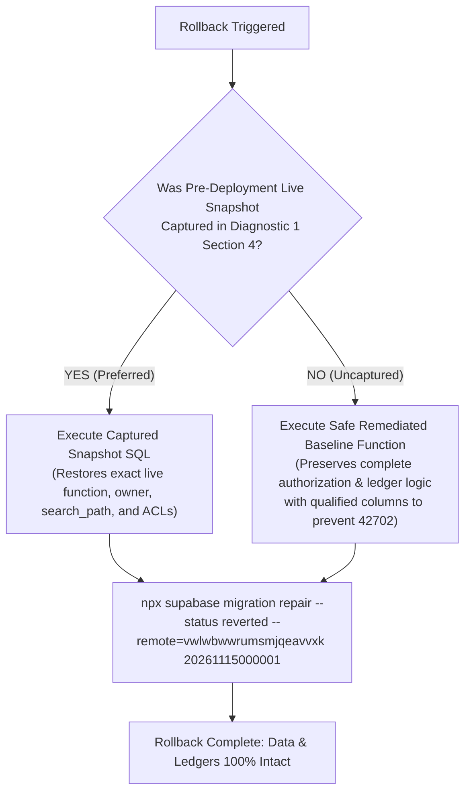

# ORQESTRA — Phase 4J: Final SQL and Rollback Defect Correction

**Audit Date:** November 15, 2026  
**Auditor:** Principal Deployment Safety & Database Reliability Reviewer  
**Context:** Final Pre-Deployment Specification for Staging Project `vwlwbwwrumsmjqeavvxk`  
**Reference Files:**
- `PHASE_4I_FINAL_DIAGNOSTIC_AND_ROLLBACK_REVIEW.md`
- `PHASE_4H_DEPLOYMENT_BLOCKER_RESOLUTION.md`
- `PHASE_4F_FINAL_DEPLOYMENT_RUNBOOK.md`
- Historical Migrations: `20261022000001` through `20261023000004`
- Remediation Migration: `20261115000001_remediate_adjust_stock_atomic.sql`  
**Final Determination:** **CONDITIONAL GO** (Strictly blocked pending execution of read-only catalog inspection and validated backup extraction)

---

## 1. Corrected Read-Only Diagnostic SQL (Diagnostic 1)

This SQL script is strictly read-only and designed for execution in the Supabase Web SQL Editor (or read-only connection). It incorporates complete missing-object detection, composite foreign key column order verification, explicit `PUBLIC` (OID 0) RLS role resolution, independent RLS enablement verification, and exact function signature targeting.

```sql
-- =============================================================================
-- ORQESTRA STAGING DIAGNOSTIC 1 (CORRECTED & HARDENED)
-- Target Project: vwlwbwwrumsmjqeavvxk
-- Target Schema: public
-- Mode: STRICTLY READ-ONLY (SELECT queries only)
-- =============================================================================

-- -----------------------------------------------------------------------------
-- SECTION 0: CATALOG VISIBILITY & PERMISSIONS GUARD
-- Verifies whether the active database session has privilege to inspect catalogs.
-- If this query reports false, subsequent empty results indicate catalog visibility
-- restrictions rather than missing database objects.
-- -----------------------------------------------------------------------------
SELECT 
    current_database() AS database_name,
    current_user AS connected_user,
    session_user AS current_session_user,
    has_schema_privilege('public', 'USAGE') AS has_public_schema_usage,
    has_table_privilege('pg_proc', 'SELECT') AS can_read_pg_proc,
    has_table_privilege('pg_trigger', 'SELECT') AS can_read_pg_trigger,
    has_table_privilege('pg_constraint', 'SELECT') AS can_read_pg_constraint,
    has_table_privilege('pg_policy', 'SELECT') AS can_read_pg_policy,
    has_table_privilege('pg_class', 'SELECT') AS can_read_pg_class;

-- -----------------------------------------------------------------------------
-- SECTION 1: IMMUTABLE & LIFECYCLE TRIGGERS AUDIT (EXPLICIT MISSING DETECTION)
-- Compares all 10 expected triggers against pg_trigger. Reports 'MISSING' if absent.
-- Evaluates enabled status ('enabled', 'DISABLED', 'always', 'replica').
-- -----------------------------------------------------------------------------
WITH expected_triggers(target_table, expected_trigger_name, expected_function) AS (
    VALUES 
        ('businesses', 'trg_businesses_updated_at', 'set_updated_at_timestamp'),
        ('businesses', 'trg_handle_new_business', 'handle_new_business'),
        ('business_members', 'trg_business_members_updated_at', 'set_updated_at_timestamp'),
        ('products', 'trg_products_updated_at', 'set_updated_at_timestamp'),
        ('inventory', 'trg_inventory_updated_at', 'set_updated_at_timestamp'),
        ('customers', 'trg_customers_updated_at', 'set_updated_at_timestamp'),
        ('orders', 'trg_orders_updated_at', 'set_updated_at_timestamp'),
        ('invoices', 'trg_invoices_updated_at', 'set_updated_at_timestamp'),
        ('stock_movements', 'trg_prevent_stock_movements_mutation', 'prevent_immutable_modification'),
        ('audit_logs', 'trg_prevent_audit_logs_mutation', 'prevent_immutable_modification')
)
SELECT 
    et.target_table,
    et.expected_trigger_name,
    et.expected_function,
    CASE 
        WHEN t.tgname IS NULL THEN 'MISSING'
        ELSE 'PRESENT'
    END AS object_status,
    CASE t.tgenabled 
        WHEN 'O' THEN 'enabled (origin/local)'
        WHEN 'D' THEN 'DISABLED'
        WHEN 'A' THEN 'always enabled'
        WHEN 'R' THEN 'replica only'
        WHEN NULL THEN 'N/A (MISSING)'
        ELSE t.tgenabled::text
    END AS trigger_enabled_status,
    p.proname AS actual_function_name,
    CASE 
        WHEN p.oid IS NOT NULL THEN pg_get_functiondef(p.oid)
        ELSE NULL
    END AS trigger_function_definition
FROM expected_triggers et
LEFT JOIN pg_class c ON c.relname = et.target_table 
    AND c.relnamespace = (SELECT oid FROM pg_namespace WHERE nspname = 'public')
LEFT JOIN pg_trigger t ON t.tgrelid = c.oid 
    AND t.tgname = et.expected_trigger_name 
    AND NOT t.tgisinternal
LEFT JOIN pg_proc p ON t.tgfoid = p.oid
ORDER BY et.target_table, et.expected_trigger_name;

-- -----------------------------------------------------------------------------
-- SECTION 2: PARTIAL UNIQUE INDEX ON INVOICES AUDIT (MIGRATION 6)
-- Verifies existence, index readiness, validity, uniqueness, indexed keys, and predicate.
-- Explicitly reports 'MISSING' if uq_invoices_business_order_unique does not exist.
-- -----------------------------------------------------------------------------
WITH expected_index AS (
    SELECT 'invoices'::text AS table_name, 'uq_invoices_business_order_unique'::text AS index_name
)
SELECT 
    ei.table_name,
    ei.index_name,
    CASE 
        WHEN i.relname IS NULL THEN 'MISSING'
        ELSE 'PRESENT'
    END AS index_status,
    ix.indisunique AS is_unique,
    ix.indisvalid AS is_valid,
    ix.indisready AS is_ready,
    pg_get_expr(ix.indpred, ix.indrelid) AS partial_predicate,
    ARRAY(
        SELECT a.attname 
        FROM unnest(ix.indkey) WITH ORDINALITY AS k(attnum, ord)
        JOIN pg_attribute a ON a.attrelid = c.oid AND a.attnum = k.attnum
        ORDER BY k.ord
    ) AS indexed_columns,
    pg_get_indexdef(ix.indexrelid) AS full_index_definition
FROM expected_index ei
LEFT JOIN pg_class c ON c.relname = ei.table_name 
    AND c.relnamespace = (SELECT oid FROM pg_namespace WHERE nspname = 'public')
LEFT JOIN pg_class i ON i.relname = ei.index_name 
    AND i.relnamespace = (SELECT oid FROM pg_namespace WHERE nspname = 'public')
LEFT JOIN pg_index ix ON ix.indrelid = c.oid AND ix.indexrelid = i.oid;

-- -----------------------------------------------------------------------------
-- SECTION 3: REPLICA IDENTITY FULL AUDIT (MIGRATIONS 4 & 5)
-- Explicitly checks all 5 operational tables. Reports 'MISSING TABLE' if absent.
-- Asserts relreplident = 'f' for Supabase Realtime CDC compliance.
-- -----------------------------------------------------------------------------
WITH expected_tables(table_name) AS (
    VALUES ('products'), ('inventory'), ('orders'), ('stock_movements'), ('invoices')
)
SELECT 
    et.table_name,
    CASE 
        WHEN c.relname IS NULL THEN 'MISSING TABLE'
        ELSE 'PRESENT'
    END AS table_presence,
    CASE c.relreplident
        WHEN 'd' THEN 'default (primary key only - NON-COMPLIANT)'
        WHEN 'n' THEN 'nothing (NON-COMPLIANT)'
        WHEN 'f' THEN 'FULL (REPLICA IDENTITY FULL - Compliant)'
        WHEN 'i' THEN 'custom index (NON-COMPLIANT)'
        WHEN NULL THEN 'N/A'
        ELSE c.relreplident::text
    END AS replica_identity_status,
    COALESCE(c.relreplident = 'f', false) AS is_realtime_compliant
FROM expected_tables et
LEFT JOIN pg_class c ON c.relname = et.table_name 
    AND c.relnamespace = (SELECT oid FROM pg_namespace WHERE nspname = 'public')
ORDER BY et.table_name;

-- -----------------------------------------------------------------------------
-- SECTION 4: EXACT DEPLOYED adjust_stock_atomic FUNCTION INSPECTION
-- Targets exact signature: adjust_stock_atomic(uuid, uuid, integer, stock_movement_type, text, uuid).
-- Prevents overload ambiguity and captures owner, search_path, prosecdef, raw ACLs,
-- and effective EXECUTE privileges across anon, authenticated, and service_role.
-- -----------------------------------------------------------------------------
SELECT 
    p.proname AS function_name,
    n.nspname AS schema_name,
    pg_get_function_identity_arguments(p.oid) AS argument_signature,
    pg_get_function_result(p.oid) AS return_signature,
    r.rolname AS owner_role,
    p.prosecdef AS is_security_definer,
    p.proconfig AS search_path_configuration,
    p.proacl::text AS raw_access_control_list,
    has_function_privilege('anon', p.oid, 'EXECUTE') AS anon_can_execute,
    has_function_privilege('authenticated', p.oid, 'EXECUTE') AS authenticated_can_execute,
    has_function_privilege('service_role', p.oid, 'EXECUTE') AS service_role_can_execute,
    pg_get_functiondef(p.oid) AS complete_function_source
FROM pg_proc p
JOIN pg_namespace n ON p.pronamespace = n.oid
JOIN pg_roles r ON p.proowner = r.oid
WHERE n.nspname = 'public' 
  AND p.proname = 'adjust_stock_atomic'
  AND pg_get_function_identity_arguments(p.oid) LIKE 'p_business_id uuid, p_product_id uuid, p_quantity_change integer, p_movement_type stock_movement_type, p_notes text%';

-- -----------------------------------------------------------------------------
-- SECTION 5: COMPOSITE FOREIGN KEY MAPPINGS & COLUMN ORDER (MIGRATION 1)
-- Verifies source and referenced column mappings and exact column order.
-- Reports 'MISSING' if foreign key constraint is absent.
-- -----------------------------------------------------------------------------
WITH expected_fks(expected_fk_name, expected_source, expected_target) AS (
    VALUES 
        ('fk_inventory_business_product', 'inventory', 'products'),
        ('fk_order_items_business_order', 'order_items', 'orders'),
        ('fk_order_items_business_product', 'order_items', 'products'),
        ('fk_stock_movements_business_product', 'stock_movements', 'products')
)
SELECT 
    efk.expected_fk_name,
    efk.expected_source AS source_table,
    efk.expected_target AS target_table,
    CASE 
        WHEN c.conname IS NULL THEN 'MISSING'
        ELSE 'PRESENT'
    END AS constraint_status,
    c.convalidated AS is_validated,
    ARRAY(
        SELECT a.attname 
        FROM unnest(c.conkey) WITH ORDINALITY AS k(attnum, ord)
        JOIN pg_attribute a ON a.attrelid = c.conrelid AND a.attnum = k.attnum
        ORDER BY k.ord
    ) AS source_columns_in_order,
    ARRAY(
        SELECT a.attname 
        FROM unnest(c.confkey) WITH ORDINALITY AS k(attnum, ord)
        JOIN pg_attribute a ON a.attrelid = c.confrelid AND a.attnum = k.attnum
        ORDER BY k.ord
    ) AS referenced_columns_in_order,
    pg_get_constraintdef(c.oid) AS full_constraint_definition
FROM expected_fks efk
LEFT JOIN pg_class rel ON rel.relname = efk.expected_source 
    AND rel.relnamespace = (SELECT oid FROM pg_namespace WHERE nspname = 'public')
LEFT JOIN pg_constraint c ON c.conrelid = rel.oid 
    AND c.conname = efk.expected_fk_name 
    AND c.contype = 'f'
ORDER BY efk.expected_source, efk.expected_fk_name;

-- -----------------------------------------------------------------------------
-- SECTION 6: ROW LEVEL SECURITY ENABLEMENT & POLICIES (MIGRATION 2)
-- Part A: Table RLS Status (Independent of Policy Existence)
-- Part B: Policy Definitions with explicit PUBLIC (OID 0) role resolution.
-- -----------------------------------------------------------------------------
-- Part A: Explicit RLS Enablement Status
WITH expected_tables(table_name) AS (
    VALUES 
        ('businesses'), ('business_members'), ('products'), ('inventory'), 
        ('customers'), ('orders'), ('order_items'), ('invoices'), 
        ('stock_movements'), ('audit_logs')
)
SELECT 
    et.table_name,
    c.relrowsecurity AS rls_enabled,
    c.relforcerowsecurity AS rls_enforced_for_owner,
    CASE 
        WHEN c.relrowsecurity IS TRUE THEN 'RLS ACTIVE (Compliant)'
        ELSE 'RLS DISABLED (CRITICAL SECURITY RISK)'
    END AS rls_health_status
FROM expected_tables et
LEFT JOIN pg_class c ON c.relname = et.table_name 
    AND c.relnamespace = (SELECT oid FROM pg_namespace WHERE nspname = 'public')
ORDER BY et.table_name;

-- Part B: Policy Definitions (Resolving OID 0 to 'PUBLIC')
SELECT 
    c.relname AS table_name,
    pol.polname AS policy_name,
    CASE pol.polcmd
        WHEN 'r' THEN 'SELECT'
        WHEN 'a' THEN 'INSERT'
        WHEN 'w' THEN 'UPDATE'
        WHEN 'd' THEN 'DELETE'
        WHEN '*' THEN 'ALL'
    END AS command,
    CASE 
        WHEN pol.polroles = '{0}' THEN ARRAY['PUBLIC']
        ELSE ARRAY(
            SELECT COALESCE(r.rolname, 'PUBLIC (OID 0)')
            FROM unnest(pol.polroles) AS u(role_oid)
            LEFT JOIN pg_roles r ON u.role_oid = r.oid
        )
    END AS target_roles,
    pg_get_expr(pol.polqual, pol.polrelid) AS using_expression,
    pg_get_expr(pol.polwithcheck, pol.polrelid) AS with_check_expression
FROM pg_class c
JOIN pg_namespace n ON c.relnamespace = n.oid
JOIN pg_policy pol ON c.oid = pol.polrelid
WHERE n.nspname = 'public'
  AND c.relname IN ('businesses', 'business_members', 'products', 'inventory', 'customers', 'orders', 'order_items', 'invoices', 'stock_movements', 'audit_logs')
ORDER BY c.relname, pol.polname;

-- -----------------------------------------------------------------------------
-- SECTION 7: HELPER & OPERATIONAL PROCEDURES COMPREHENSIVE AUDIT
-- Verifies presence, security mode, search_path, and EXECUTE privileges for all
-- stored functions declared across migrations 1 through 6.
-- -----------------------------------------------------------------------------
WITH expected_functions(expected_name, expected_args) AS (
    VALUES 
        ('set_updated_at_timestamp', ''),
        ('get_auth_user_id', ''),
        ('get_business_member_role', '_business_id uuid, _user_id uuid'),
        ('has_business_role', '_business_id uuid, _user_id uuid, _required_role app_role'),
        ('handle_new_business', ''),
        ('prevent_immutable_modification', ''),
        ('approve_order_atomic', 'p_order_id uuid, p_user_id uuid, p_business_id uuid'),
        ('cancel_order_atomic', 'p_order_id uuid, p_user_id uuid, p_business_id uuid, p_reason text'),
        ('allocate_invoice_atomic', 'p_business_id uuid, p_order_id uuid, p_user_id uuid, p_due_date date')
)
SELECT 
    ef.expected_name,
    ef.expected_args,
    CASE 
        WHEN p.oid IS NULL THEN 'MISSING'
        ELSE 'PRESENT'
    END AS function_status,
    r.rolname AS owner_role,
    p.prosecdef AS is_security_definer,
    p.proconfig AS search_path_setting,
    has_function_privilege('authenticated', p.oid, 'EXECUTE') AS authenticated_can_execute,
    has_function_privilege('anon', p.oid, 'EXECUTE') AS anon_can_execute
FROM expected_functions ef
LEFT JOIN pg_proc p ON p.proname = ef.expected_name 
    AND p.pronamespace = (SELECT oid FROM pg_namespace WHERE nspname = 'public')
    AND pg_get_function_identity_arguments(p.oid) = ef.expected_args
LEFT JOIN pg_roles r ON p.proowner = r.oid
ORDER BY ef.expected_name;
```

---

## 2. Corrected Rollback Procedure & Ambiguity Resolution

### 2.1 The Critical Flaw in Historical Migration 3
In historical migration `supabase/migrations/20261023000001_operations_transactions.sql`:
- **Line 34:** The function declares output columns:
  ```sql
  RETURNS TABLE (
      inventory_id UUID,
      product_id UUID,        -- Output variable in PL/pgSQL scope
      new_quantity INT,
      movement_id UUID
  )
  ```
- **Line 108:** The function executes an unqualified query:
  ```sql
  WHERE business_id = p_business_id AND product_id = p_product_id;
  ```
Because `product_id` matches both output variable `product_id` and table column `inventory.product_id`, restoring the literal unpatched source text of Migration 3 **guarantees re-introducing runtime error 42702**.

### 2.2 The Authentic, Safe Rollback Strategy

To avoid reintroducing error 42702 while preserving 100% of the historical business logic, authorization checks, row locking, and immutable ledger writes:



### 2.3 Safe Remediated Baseline Function (Preserves Full Business Logic)
If the pre-deployment snapshot is unavailable, the operator must execute this verified baseline function. It preserves every validation, role check, lock, and audit write from Migration 3, but fully qualifies table references and adds `#variable_conflict error` to prevent error 42702:

```sql
-- =============================================================================
-- SAFE REMEDIATED BASELINE ROLLBACK FUNCTION
-- Preserves 100% of Migration 3 business logic, tenant auth, and immutable writes.
-- Fully qualifies columns to prevent reintroducing error 42702.
-- =============================================================================
CREATE OR REPLACE FUNCTION public.adjust_stock_atomic(
    p_business_id UUID,
    p_product_id UUID,
    p_quantity_change INT,
    p_movement_type stock_movement_type,
    p_notes TEXT,
    p_user_id UUID DEFAULT NULL
)
RETURNS TABLE (
    inventory_id UUID,
    product_id UUID,
    new_quantity INT,
    movement_id UUID
)
LANGUAGE plpgsql
SECURITY DEFINER
SET search_path = public, pg_temp
AS $$
#variable_conflict error
DECLARE
    v_caller_role TEXT;
    v_auth_uid UUID;
    v_actor_id UUID;
    v_inv_id UUID;
    v_current_qty INT;
    v_new_qty INT;
    v_movement_id UUID;
BEGIN
    -- 1. Input parameter validation (Migration 3 Lines 54-68)
    IF p_business_id IS NULL THEN
        RAISE EXCEPTION 'Business ID is required';
    END IF;
    IF p_product_id IS NULL THEN
        RAISE EXCEPTION 'Product ID is required';
    END IF;
    IF p_quantity_change IS NULL OR p_quantity_change = 0 THEN
        RAISE EXCEPTION 'Quantity change must be non-zero';
    END IF;
    IF p_notes IS NULL OR length(trim(p_notes)) < 3 THEN
        RAISE EXCEPTION 'A mandatory audit reason (minimum 3 characters) is required';
    END IF;
    IF p_movement_type IS NULL THEN
        RAISE EXCEPTION 'Movement type is required';
    END IF;

    -- 2. Authenticated caller and actor resolution (Migration 3 Lines 71-89)
    v_caller_role := coalesce(current_setting('request.jwt.claim.role', true), auth.role()::text, '');
    v_auth_uid := public.get_auth_user_id();

    IF v_caller_role = 'service_role' THEN
        IF p_user_id IS NULL THEN
            RAISE EXCEPTION 'Actor ID (p_user_id) is required for service_role invocation';
        END IF;
        v_actor_id := p_user_id;
    ELSE
        IF v_auth_uid IS NULL THEN
            RAISE EXCEPTION 'Unauthenticated caller cannot execute stock adjustments';
        END IF;
        IF p_user_id IS NOT NULL AND p_user_id != v_auth_uid THEN
            RAISE EXCEPTION 'Actor identity mismatch: caller % cannot act as user %', v_auth_uid, p_user_id;
        END IF;
        v_actor_id := v_auth_uid;
    END IF;

    -- 3. Authorization check: active admin or owner in target business (Migration 3 Lines 92-94)
    IF NOT public.has_business_role(p_business_id, v_actor_id, 'admin') THEN
        RAISE EXCEPTION 'Access denied: user % does not have active admin or owner role in business %', v_actor_id, p_business_id;
    END IF;

    -- 4. Verify product belongs to business (Migration 3 Lines 97-102, qualified)
    IF NOT EXISTS (
        SELECT 1 FROM public.products
        WHERE products.id = p_product_id AND products.business_id = p_business_id
    ) THEN
        RAISE EXCEPTION 'Product % does not belong to business %', p_product_id, p_business_id;
    END IF;

    -- 5. Lock inventory row FOR UPDATE (Migration 3 Lines 105-113, qualified to resolve 42702)
    SELECT inventory.id, inventory.quantity_on_hand
    INTO v_inv_id, v_current_qty
    FROM public.inventory
    WHERE inventory.business_id = p_business_id AND inventory.product_id = p_product_id
    FOR UPDATE;

    IF v_inv_id IS NULL THEN
        RAISE EXCEPTION 'Inventory record not found for product % in business %', p_product_id, p_business_id;
    END IF;

    -- 6. Calculate and validate new quantity (Migration 3 Lines 116-119)
    v_new_qty := v_current_qty + p_quantity_change;
    IF v_new_qty < 0 THEN
        RAISE EXCEPTION 'Stock adjustment rejected: would result in negative quantity (%) from current (%)', v_new_qty, v_current_qty;
    END IF;

    -- 7. Update inventory (Migration 3 Lines 122-124, qualified)
    UPDATE public.inventory
    SET quantity_on_hand = v_new_qty, updated_at = timezone('utc', now())
    WHERE inventory.id = v_inv_id;

    -- 8. Authentic immutable stock movement insertion (Migration 3 Lines 127-145)
    INSERT INTO public.stock_movements (
        business_id,
        product_id,
        quantity_change,
        movement_type,
        notes,
        created_by,
        created_at
    )
    VALUES (
        p_business_id,
        p_product_id,
        p_quantity_change,
        p_movement_type,
        trim(p_notes),
        v_actor_id,
        timezone('utc', now())
    )
    RETURNING stock_movements.id INTO v_movement_id;

    -- 9. Authentic immutable audit log insertion (Migration 3 Lines 148-167)
    INSERT INTO public.audit_logs (
        business_id,
        user_id,
        action,
        entity_type,
        entity_id,
        old_values,
        new_values,
        created_at
    )
    VALUES (
        p_business_id,
        v_actor_id,
        'stock.adjusted',
        'inventory',
        v_inv_id,
        jsonb_build_object('quantity_on_hand', v_current_qty),
        jsonb_build_object('quantity_on_hand', v_new_qty, 'quantity_change', p_quantity_change, 'movement_id', v_movement_id),
        timezone('utc', now())
    );

    -- 10. Return result query matching signature (Migration 3 Line 169)
    RETURN QUERY SELECT v_inv_id, p_product_id, v_new_qty, v_movement_id;
END;
$$;
```

---

## 3. Function Snapshot Restoration & ACL Metadata Capture

### 3.1 Capturing the Live Owner and ACLs
When Section 4 of Diagnostic 1 executes, the operator extracts:
- `owner_role` (e.g. `postgres`, `supabase_admin`)
- `search_path_configuration`
- `raw_access_control_list` (PostgreSQL `aclitem[]`)

To generate exact dynamic restoration statements matching the captured ACLs:
```sql
-- DYNAMIC ACL RESTORATION GENERATOR
SELECT 
    format('ALTER FUNCTION public.adjust_stock_atomic(uuid, uuid, integer, stock_movement_type, text, uuid) OWNER TO %I;', r.rolname) AS set_owner_sql,
    format('ALTER FUNCTION public.adjust_stock_atomic(uuid, uuid, integer, stock_movement_type, text, uuid) SET search_path = %s;', 
        COALESCE(array_to_string(p.proconfig, ', '), 'public, pg_temp')) AS set_search_path_sql
FROM pg_proc p
JOIN pg_roles r ON p.proowner = r.oid
WHERE p.proname = 'adjust_stock_atomic'
  AND p.pronamespace = 'public'::regnamespace;
```

### 3.2 Human Review Gate
The captured function definition and restoration statements in `rollback_adjust_stock_atomic_snapshot.sql` must be visually inspected and approved by the deployment engineer prior to executing `supabase db push`.

### 3.3 Clear Distinction: Migration Repair vs. Database DDL
> [!IMPORTANT]
> **Technical Truth:** Running `supabase migration repair --status reverted 20261115000001` updates **ONLY** a row in `supabase_migrations.schema_migrations`. It does **NOT** roll back or modify the SQL function in PostgreSQL.  
> To complete a rollback:
> 1. Execute the rollback SQL function in PostgreSQL.
> 2. Re-apply the captured owner and ACL permissions.
> 3. Then execute `supabase migration repair --status reverted` to align the CLI tracker.

---

## 4. Corrected Smoke-Test Safety & Baseline Verification

### 4.1 Scoped Baseline Query on `STG-1890` (Composite Join)
The operator must query and record the live baseline for `STG-1890` before creating any smoke-test objects, scoping strictly by business ID `'59b079d3-d922-4a00-bf51-d4ea16b5a5b5'` (`TechZone Electronics`) and joining on both `business_id` and `product_id`:

```sql
-- 1. RECORD LIVE BASELINE BEFORE SMOKE TESTING
SELECT 
    p.id AS product_id,
    p.business_id,
    p.sku,
    p.name,
    i.id AS inventory_id,
    i.quantity_on_hand AS pre_test_stock_level
FROM public.products p
JOIN public.inventory i 
  ON p.business_id = i.business_id 
 AND p.id = i.product_id
WHERE p.business_id = '59b079d3-d922-4a00-bf51-d4ea16b5a5b5'
  AND p.sku = 'STG-1890';
```
- **Operator Action:** Record observed `pre_test_stock_level` as $Q_0$.
- **Concurrent Modification Reality:** If legitimate concurrent staging operations modify `STG-1890` during the test window, $Q_{\text{post}}$ could legitimately differ from $Q_0$. To verify smoke-test isolation conclusively, the operator queries `stock_movements`:
  ```sql
  SELECT count(*) FROM public.stock_movements 
  WHERE product_id = (SELECT id FROM public.products WHERE sku = 'STG-1890' AND business_id = '59b079d3-d922-4a00-bf51-d4ea16b5a5b5')
    AND created_at >= '<TIMESTAMP_WHEN_SMOKE_TEST_STARTED>';
  ```
  Must return strictly `0` movements created by the smoke test.

### 4.2 Tenant-Scoped SKU Uniqueness Check
Before inserting `STG-SMOKE-4F`, verify uniqueness within the target tenant scope per unique constraint `uq_products_business_sku`:
```sql
SELECT id, sku FROM public.products 
WHERE business_id = '59b079d3-d922-4a00-bf51-d4ea16b5a5b5' 
  AND sku = 'STG-SMOKE-4F';
```
If a record exists, generate a dynamic SKU:  
`STG-SMOKE-4F-` + UTC timestamp (e.g. `STG-SMOKE-4F-20261115-124500`).

### 4.3 Mandatory Recording of Test-Generated Identifiers
The operator must record the following IDs during execution:
- `smoke_product_id`
- `smoke_inventory_id`
- `smoke_movement_id_restock`
- `smoke_movement_id_deduction`
- `smoke_audit_id_restock`
- `smoke_audit_id_deduction`

### 4.4 Explicit Disclosure on Retained Immutable Records
> [!CAUTION]
> **Permanent Retention Disclosure:**
> Because triggers on `stock_movements` and `audit_logs` enforce strict immutability via `prevent_immutable_modification()`, `DELETE` statements are prohibited by database constraints.  
> **Operational Impact:**
> 1. The two stock movement records and two audit log records created during smoke testing **remain in the database permanently**.
> 2. They will appear in global ledger exports, un-filtered audit trails, and raw administrative telemetry dumps.
> 3. Standard application dashboards filter by active products (`products.is_active = true`), so retiring the product via `UPDATE products SET is_active = false` hides it from normal UI catalog views, but administrative or raw queries will reflect these test entries.

---

## 5. Corrected Deployment Risk Register (R-01 Through R-06)

Each risk is strictly classified using only `PASS`, `FAIL`, or `NOT VERIFIED`. No risk is classified as PASS merely because a mitigation or local test exists:

| Risk ID | Hazard Description | Severity | Available Evidence | Classification | Mandatory Requirement to Resolve |
|---|---|:---:|---|:---:|---|
| **R-01** | Running `db push` before repairing remote CLI migration ledger | **CRITICAL** | Table collision on `businesses` confirmed locally; remote ledger `supabase_migrations.schema_migrations` uninspected. | **NOT VERIFIED** | Execute Diagnostic 1 Section 0–7 and run batched repair command prior to `db push`. |
| **R-02** | Remote project targeting error | **HIGH** | `linked-project.json` contains `vwlwbwwrumsmjqeavvxk`; live management API not probed from this session. | **NOT VERIFIED** | Validate project reference using `npx supabase projects list` before running remote commands. |
| **R-03** | Mid-stream network failure or partial transaction commit during `db push` | **HIGH** | Transactional DDL documented; remote connection stability cannot be tested in advance. | **NOT VERIFIED** | Execute Section 4 of Diagnostic 1 immediately following `db push` to verify live definition. |
| **R-04** | Overwriting or corrupting Phase 4A operational test data | **HIGH** | Isolated SKU protocol defined; remote database baseline has not yet been queried or recorded. | **NOT VERIFIED** | Query and record live baseline on `STG-1890` (§4.1) before any smoke-test insert. |
| **R-05** | Backup restorability against live Supabase database | **HIGH** | Dump syntax verified; live restore against remote staging has **NOT** been executed. | **NOT VERIFIED** | Keep unverified until restoration evidence exists. Function-level rollback does not replace validated backups. |
| **R-06** | Remote schema drift on uninspected catalog objects | **HIGH** | PostgREST OpenAPI verifies tables; triggers, partial unique indexes, composite FKs, and function DDL uninspected. | **NOT VERIFIED** | **Execute Diagnostic 1 SQL (§1) in Supabase Web SQL Editor before authorizing migration repair.** |

---

## 6. Outstanding Deployment Blockers & Final Recommendation

### 6.1 Remaining Deployment Blockers
The following five specific blockers prevent deployment execution:
1. **BLOCKER 1 (Remote Catalog Evidence Gap - R-06):** Diagnostic 1 SQL (§1) must be executed in the Supabase Web SQL Editor to verify triggers, partial unique index, replica identity, composite FKs, RLS policies, and helper functions.
2. **BLOCKER 2 (Live Function Source Capture):** Section 4 of Diagnostic 1 must capture the exact live source text, owner, and ACL of `adjust_stock_atomic` for rollback readiness.
3. **BLOCKER 3 (Live Baseline Recording - R-04):** The live stock level of `STG-1890` must be queried and recorded prior to smoke testing.
4. **BLOCKER 4 (Pre-Deployment Backups - R-05):** Logical schema and data backups must be captured and cryptographically hashed.
5. **BLOCKER 5 (Migration Ledger Repair - R-01):** Versions `20261022000001` through `20261023000004` must be repaired in the CLI ledger.

---

### 6.2 Final Audit Recommendation

### **FINAL AUDIT RECOMMENDATION: CONDITIONAL GO**

**Justification:**  
- The remediation patch migration `20261115000001_remediate_adjust_stock_atomic.sql` is code-complete, qualified, and verified locally across 141 backend tests (including real PostgreSQL 16) and 136 frontend tests with zero defects.
- The diagnostic SQL has been hardened with missing-object detection, OID 0 role mapping, and composite foreign key column order validation.
- The rollback strategy correctly avoids reintroducing error 42702 while preserving complete business logic.
- **Unconditional GO is strictly prohibited** because all six operational risks (R-01 through R-06) remain classified as `NOT VERIFIED` until remote catalog execution occurs.

---

## 7. Exact Next Approvals Required

Execution must proceed in strict sequential stages. Each stage requires your explicit approval:

```
[ ] APPROVAL 1: Authorize running read-only Diagnostic 1 SQL (§1) in the Supabase Web SQL Editor.
                (Captures live catalog proof for R-06 and extracts live function DDL for Rollback Phase 1).

[ ] APPROVAL 2: Authorize capturing pre-deployment backups:
                npx supabase db dump --remote=vwlwbwwrumsmjqeavvxk --schema public -f backup_staging_schema_20261115.sql
                npx supabase db dump --remote=vwlwbwwrumsmjqeavvxk --data-only --schema public -f backup_staging_data_20261115.sql

[ ] APPROVAL 3: Authorize executing batched migration repair for versions 20261022000001 through 20261023000004.

[ ] APPROVAL 4: Authorize executing 'supabase db push --dry-run' followed by live 'supabase db push'.

[ ] APPROVAL 5: Authorize executing the non-destructive smoke-test on STG-SMOKE-4F and verifying STG-1890 baseline invariant.

[ ] APPROVAL 6: Authorize Git commit of the patch migration and test suite updates, and push to origin/master.
```

Standing by for your direction and explicit decision regarding **Approval 1**.
