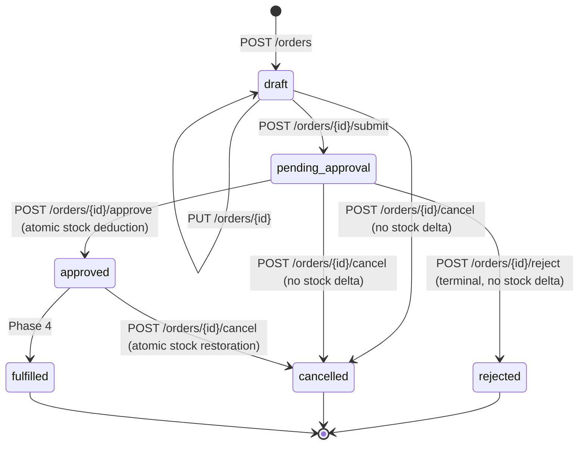

# Orqestra System Architecture (Phase 4)

## 1. Overview & Purpose

Orqestra is an AI-assisted business operations platform engineered for small businesses to coordinate inventory, order processing, customer records, and invoicing with verified business logic and reliable human-in-the-loop workflows.

Phase 2 establishes the database schema foundation, authentication verification, and Row Level Security (RLS) data isolation.

---

## 2. Core Architecture Principles

1. **AI as Assistant, Not Final Authority**:
   Deterministic backend logic validates products, prices, quantities, inventory, permissions, and transaction outcomes. AI is never permitted to directly deduct inventory or approve financial transactions.
2. **Separation of Concerns**:
   Routing layers (`api/`), configuration layers (`core/`), domain schemas (`schemas/`), service logic (`services/`), and data access (`repositories/`) are strictly isolated.
3. **Database-Level Multi-Tenant Isolation**:
   Every business entity includes an immutable `business_id`. Row Level Security (RLS) policies in PostgreSQL enforce data boundaries independently of application code.
4. **Non-Recursive RLS Architecture**:
   Membership and role verification use PostgreSQL `SECURITY DEFINER` helper functions to bypass RLS during permission lookups, eliminating recursive policy evaluation bugs.
5. **Verified Diagnostics Only**:
   Health endpoints report solely what has been inspected and confirmed active. No mock operational claims are made for unconfigured services.

---

## 3. Database Schema Design (`supabase/migrations/`)

The Phase 2 schema defines 10 core tables:

### 3.1 Entity Relationship Diagram

```text
[businesses]
   |-- 1:N --> [business_members] (users and roles: owner, admin, staff)
   |-- 1:N --> [products] (catalog, pricing, SKUs)
   |              |-- 1:1 --> [inventory] (stock levels, thresholds)
   |              |-- 1:N --> [stock_movements] (auditable inventory ledger)
   |              |-- 1:N --> [order_items] (line items)
   |-- 1:N --> [customers] (business customer directory)
   |-- 1:N --> [orders] (sales orders, status, approval state)
   |              |-- 1:N --> [order_items]
   |              |-- 1:N --> [invoices] (billing records)
   |-- 1:N --> [audit_logs] (immutable administrative log)
```

### 3.2 Tables and Constraints

| Table | Primary Key | Tenancy Key | Important Constraints & Characteristics |
| :--- | :--- | :--- | :--- |
| `businesses` | `id UUID` | Root Entity | `name`, unique `slug`, `currency`, `created_at`, `updated_at`. `trg_on_business_created` auto-enrolls creator as owner. |
| `business_members` | `id UUID` | `business_id` | Foreign key to `auth.users(id)`. `UNIQUE(business_id, user_id)`. Role enum (`owner`, `admin`, `staff`). Anti-escalation RLS. |
| `products` | `id UUID` | `business_id` | `UNIQUE(business_id, sku)`. `UNIQUE(business_id, id)`. `unit_price NUMERIC(12, 2) CHECK (unit_price >= 0)`. |
| `inventory` | `id UUID` | `business_id` | Composite FK `(business_id, product_id)` -> `products(business_id, id)`. `quantity_on_hand INT CHECK (>= 0)`. |
| `customers` | `id UUID` | `business_id` | `UNIQUE(business_id, id)`. Minimal necessary contact data; avoids storing sensitive personal data. |
| `orders` | `id UUID` | `business_id` | `UNIQUE(business_id, id)`. Composite FK to customers. `status` enum, monetary `NUMERIC(12, 2) CHECK (>= 0)`. |
| `order_items` | `id UUID` | `business_id` | Composite FKs `(business_id, order_id)` and `(business_id, product_id)`. Non-negative prices and quantities. |
| `invoices` | `id UUID` | `business_id` | Composite FKs `(business_id, order_id)` and `(business_id, customer_id)`. `invoice_number`, `amount_due NUMERIC(12, 2)`. |
| `stock_movements` | `id UUID` | `business_id` | Composite FK `(business_id, product_id)`. Protected by `trg_stock_movements_immutable` (UPDATE/DELETE fail fatally). |
| `audit_logs` | `id UUID` | `business_id` | Immutable security log. Protected by `trg_audit_logs_immutable` (UPDATE/DELETE fail fatally). |

---

## 4. Role Hierarchy & Authorization Model

Orqestra defines a 3-tier role hierarchy within each business:

```text
  [Owner]   (Level 3) -> Full administrative control, member management, business deletion
     v
  [Admin]   (Level 2) -> Operational management (products, inventory, order approvals, member invitations)
     v
  [Staff]   (Level 1) -> Daily operations (viewing inventory, order entry, customer management)
```

### Role Permissions Matrix

| Capability | Staff | Admin | Owner |
| :--- | :---: | :---: | :---: |
| View Products, Inventory, Customers, Orders | Yes | Yes | Yes |
| Create & Update Customers, Draft Orders | Yes | Yes | Yes |
| Create & Update Products & Inventory | No | Yes | Yes |
| Approve Orders & Adjust Stock | No | Yes | Yes |
| Generate & Issue Invoices | No | Yes | Yes |
| Invite Staff Members | No | Yes | Yes |
| Promote / Demote Member Roles | No | No | Yes |
| Remove Members | No | No | Yes |
| Delete Business | No | No | Yes |

---

## 5. Row Level Security Policy Design

PostgreSQL Row Level Security is enabled on all 10 tables:

### 5.1 Non-Recursive Security Functions
To prevent infinite recursion when checking user permissions on `business_members`:
```sql
CREATE OR REPLACE FUNCTION public.has_business_role(
    _business_id UUID,
    _user_id UUID,
    _required_role app_role
)
RETURNS BOOLEAN
LANGUAGE plpgsql
SECURITY DEFINER
SET search_path = public
STABLE
AS $$ ... $$;
```
Because the function executes with `SECURITY DEFINER` and a pinned `search_path`, its internal query on `business_members` executes without re-triggering the table's RLS policies.

---

## 6. Server-Side Supabase Authentication in FastAPI

### 6.1 Token Verification Flow
1. Client sends `Authorization: Bearer <access_token>`.
2. `TokenVerificationService` in `backend/app/services/auth.py`:
   - Inspects JWT unverified header to reject algorithm confusion attacks (`alg` must match `SUPABASE_JWT_ALGORITHM`, e.g. `HS256`).
   - Verifies cryptographic signature using `SUPABASE_JWT_SECRET`.
   - Validates `exp` (expiration), `aud` (audience), and extracts `sub` (subject UUID).
   - Rejects expired, forged, or malformed tokens with HTTP 401.
3. `AuthorizationService` in `backend/app/services/authorization.py`:
   - Inspects user's verified business membership using `BaseBusinessRepository`.
   - Prevents cross-business access: checks that the user belongs to the business passed in `X-Business-ID`.
   - Enforces role requirements (`require_business_role`).
   - Rejects unauthorized or cross-tenant access with HTTP 403.

---

## 7. Phase 3: Core Business Operations & Transaction Architecture

### 7.1 New API Endpoints (Version 1)

All endpoints require `Authorization: Bearer <token>` and `X-Business-ID: <uuid>`:

| Resource | Method | Path | Required Role | Description |
| :--- | :--- | :--- | :--- | :--- |
| **Products** | `GET` | `/api/v1/products` | `staff` | Paginated catalog listing with search and active filter. |
| | `POST` | `/api/v1/products` | `admin` | Create catalog item and auto-provision inventory record. |
| | `GET` | `/api/v1/products/{id}` | `staff` | Retrieve product details with current stock levels. |
| | `PUT` | `/api/v1/products/{id}` | `admin` | Update product name, description, unit price, cost price. |
| | `PATCH` | `/api/v1/products/{id}/deactivate` | `admin` | Soft-deactivate product to preserve referential history. |
| **Inventory** | `GET` | `/api/v1/inventory` | `staff` | List stock on hand, reorder thresholds, low stock alerts. |
| | `POST` | `/api/v1/inventory/adjust` | `admin` | Execute controlled manual adjustment with mandatory reason. |
| | `GET` | `/api/v1/inventory/history` | `staff` | View immutable movement history ledger (`stock_movements`). |
| **Customers** | `GET` | `/api/v1/customers` | `staff` | Paginated customer directory with search and active filter. |
| | `POST` | `/api/v1/customers` | `staff` | Create new customer contact record. |
| | `GET` | `/api/v1/customers/{id}` | `staff` | Retrieve customer profile and notes. |
| | `PUT` | `/api/v1/customers/{id}` | `staff` | Update customer address, phone, contact information. |
| | `PATCH` | `/api/v1/customers/{id}/deactivate` | `admin` | Soft-deactivate customer while preserving order history. |
| **Orders** | `GET` | `/api/v1/orders` | `staff` | Paginated order list with status filter. |
| | `POST` | `/api/v1/orders` | `staff` | Create draft order with server-calculated decimal totals. |
| | `GET` | `/api/v1/orders/{id}` | `staff` | Retrieve order detail with line items. |
| | `PUT` | `/api/v1/orders/{id}` | `staff` | Update line items and notes on `draft` orders only. |
| | `POST` | `/api/v1/orders/{id}/submit` | `staff` | Submit order for review (`draft` -> `pending_approval`). |
| | `POST` | `/api/v1/orders/{id}/approve` | `admin` | Atomically reserve/deduct stock and approve order. |
| | `POST` | `/api/v1/orders/{id}/reject` | `admin` | Reject order with logged reason (`pending_approval` -> `rejected`). |
| | `POST` | `/api/v1/orders/{id}/cancel` | `admin` | Cancel order; restores stock if previously approved. |

### 7.2 Order Lifecycle & State Machine



- **Draft**: Order line items can be freely edited. No inventory is deducted or reserved. Client-supplied totals are discarded; server recalculates `subtotal`, `tax`, and `total_amount` using exact `Decimal` arithmetic.
- **Pending Approval**: Order is locked from edits and presented to operators with approval permissions (`admin`, `owner`).
- **Approved**: Approval atomically inspects current on-hand stock for all line items under row-level lock (`SELECT ... FOR UPDATE`). If all items have sufficient stock, inventory is decremented, `stock_movements` ledger entries are written, and an `audit_logs` entry is recorded.
- **Rejected**: Order is rejected by an administrator. Status is terminal. No stock movement occurs.
- **Cancelled**: If an order was already `approved`, cancelling atomically increments the on-hand stock by the exact ordered quantities and writes corresponding `return` entries in `stock_movements`.

### 7.3 Transaction Boundaries & Concurrency Guarantees

Consequential inventory and order state transitions are executed atomically in PostgreSQL via `SECURITY DEFINER` stored procedures:
1. `adjust_stock_atomic(_business_id, _product_id, _delta, _type, _notes, _user_id)`:
   - Locks the target `inventory` row using `SELECT ... FOR UPDATE`.
   - Validates that `quantity_on_hand + _delta >= 0`. Prevents negative stock.
   - Updates `inventory.quantity_on_hand`.
   - Inserts immutable `stock_movements` record.
   - Inserts `audit_logs` record.
2. `approve_order_atomic(_business_id, _order_id, _user_id)`:
   - Locks the `orders` row with `FOR UPDATE`.
   - Validates order is in `pending_approval` status. Rejects repeated approvals or approving cancelled/rejected orders.
   - Sorts product IDs and locks all corresponding `inventory` rows with `FOR UPDATE` to prevent deadlocks and concurrent overselling.
   - Verifies sufficient stock for every line item. If any single product is insufficient, rolls back the entire transaction and raises an exception.
   - Decrements stock, writes `stock_movements` with `movement_type = 'order_deduction'`, transitions order status to `approved`, and writes `audit_logs`.
3. `cancel_order_atomic(_business_id, _order_id, _user_id, _reason)`:
   - Locks the `orders` row with `FOR UPDATE`.
   - If previous status was `approved`, locks all corresponding `inventory` rows, increments stock, writes `return` stock movements, and logs the cancellation in `audit_logs`.

---

## 8. Secure Realtime Synchronization Architecture (Phase 4)

### 8.1 Database Publication & Replica Identity (`20261023000002_realtime_publications.sql`)
Supabase Realtime broadcasts changes via PostgreSQL logical replication through the `supabase_realtime` publication.
- **Publication Registration**: Tables `products`, `inventory`, `orders`, and `stock_movements` are registered with `supabase_realtime`.
- **`REPLICA IDENTITY FULL`**: Configured on all four operational tables. By default, PostgreSQL logical replication only includes primary keys on `UPDATE` and `DELETE` events. `FULL` ensures that old and new record payloads include `business_id`, enabling PostgreSQL Row Level Security and Realtime client filters to evaluate tenancy permissions accurately.
- **RLS Boundary**: Subscribing clients receive only events for rows permitted by the existing `SELECT` RLS policies (`public.has_business_role(business_id, auth.uid(), 'staff')`).

### 8.2 Frontend Realtime Lifecycle (`RealtimeProvider` & `useRealtime`)
- **Authentication Gate**: Channels are created strictly after user session verification and server-confirmed business membership (`serverAuth?.active_business?.business_id`). Unauthenticated visitors or sessions without active business memberships never initiate websocket connections.
- **Token Synchronization**: Synchronizes active bearer token to the Realtime client via `supabase.realtime.setAuth(session.access_token)`.
- **Deterministic Channel Scoping**: Channels are explicitly named `realtime:business:${businessId}`.
- **Tenant Filtering**: Table subscriptions specify `filter: business_id=eq.${businessId}`. The dispatcher inspects incoming payloads and silently discards events with mismatched or foreign business IDs.
- **Zero-Leak Teardown**: Switching active businesses or signing out immediately invokes `supabase.removeChannel(channel)`, flushes event deduplication caches, and resets connection status to `disconnected`.
- **Event Deduplication**: Incoming events are checked against a bounded LRU/Set of composite keys (`${table}:${id}:${eventType}:${commit_timestamp}`) to prevent duplicate event handling from socket retransmissions.

### 8.3 Non-Authoritative State Reconciliation
- Realtime events are strictly non-authoritative signals. They never mutate business balances, execute stock deductions, or bypass database stored procedures.
- When an event arrives, components invoke debounced API refreshes (e.g. `loadProducts()`, `loadInventory()`, `loadOrders()`) against authoritative FastAPI endpoints.
- Active detail views (such as the selected order modal) detect relevant updates and re-fetch fresh server records via `fetchOrder()`.

### 8.4 Reconnection & Resiliency
- Connection states (`connecting`, `connected`, `disconnected`, `error`) are managed in state.
- Upon recovering from network drops or timeouts (`SUBSCRIBED`), reconnect listeners are notified to reconcile stale data.
- Operators are provided with an accessible connection status badge (`RealtimeStatusBadge`) and a manual "Retry" path.

---

## 9. AI Order Intake & Deterministic Catalog Matching (Phase 5)

### 9.1 Untrusted Input & Prompt Injection Defense
- **Untrusted Ingress**: Customer messages (from pasted WhatsApp, email, or chat) are treated as untrusted text.
- **System Prompt Boundaries**: The AI prompt explicitly isolates the customer message inside delimited boundaries (`CUSTOMER MESSAGE START` / `CUSTOMER MESSAGE END`).
- **Prompt Injection Defense**: Explicit instructions prevent user-supplied commands from altering extraction instructions, executing SQL, revealing system prompts, or bypassing schema validation.
- **Strict JSON Schema Enforcement**: The OpenAI-compatible API is called with `response_format={"type": "json_object"}`. Model responses are parsed strictly against the Pydantic schema `AIOrderExtractionOutput`. Any malformed or non-conforming responses raise `AIExtractionError` without fabricating data.
- **Credential Safety**: `AI_API_KEY` is loaded from server environment variables only and is never exposed to the frontend. If unconfigured, the endpoint returns an HTTP 503 error with `code="AI_NOT_CONFIGURED"`, allowing operators to use the manual entry fallback without disruption.

### 9.2 Deterministic Product Catalog Resolution
- **Non-Authoritative Proposals**: Model outputs candidate product names and quantities only. It never provides prices, inventory counts, or persistence operations.
- **Matching Algorithm**:
  1. *Exact SKU Match*: Case-insensitive match against active product SKUs.
  2. *Exact Name Match*: Case-insensitive match against product names.
  3. *Substring / Token Match*: Substring inclusion or word token matching.
  - If exactly 1 active product matches, it is marked as `matched`.
  - If multiple active products match, it is flagged as `ambiguous` with potential matches listed.
  - If 0 products match, it is flagged as `unmatched`.
- **Database-Derived Unit Prices**: Prices are retrieved exclusively from the active business product catalog in the database.
- **Exact Decimal Totals**: Subtotals, taxes (8.00%), and order amounts are calculated on the backend using Python `Decimal` arithmetic.
- **Customer Reference Resolution**: Candidate customer names are matched against the business's active customer directory. Unmatched customers require operator selection or manual creation.

### 9.3 Human Review & Confirmation Lifecycle
- **Operator Review UI (`AIOpsPage`)**: Displays the original message, candidate line items, match badges (`Matched`, `Ambiguous Match`, `Unmatched`), catalog dropdowns for resolving uncertain items, editable quantities, authoritative prices, and exact Decimal totals.
- **Draft Creation Gate**: Operators must explicitly confirm the proposal before any order is persisted. Ambiguous or unmatched items block draft order creation until resolved.
- **Stock Deduction Independence**: Creating a draft order does NOT deduct or reserve stock. Stock deduction remains strictly confined to the existing atomic approval workflow (`POST /api/v1/orders/{order_id}/approve` via `approve_order_atomic`).
- **Manual Entry Fallback**: Operates independently of the AI provider, allowing operators to create orders directly at all times.

---

## 10. Invoice Allocation & PDF Generation Architecture (Phase 5)

### 10.1 Transaction-Safe Sequential Allocation (`allocate_invoice_atomic`)
- **Forward-Only Migrations (`20261023000003_invoices_and_allocation.sql` & `20261023000004_invoice_snapshots_and_constraints.sql`)**:
  - Implements the SECURITY DEFINER function `public.allocate_invoice_atomic(p_business_id, p_order_id, p_user_id, p_due_date)`.
  - **Caller Authentication**: Verifies `p_user_id = auth.uid()` to prevent caller spoofing.
  - **Role Verification**: Verifies `public.has_business_role(p_business_id, auth.uid(), 'admin')` (only admins or owners can allocate invoices).
  - **Hardened Lock Ordering**: Locks the parent `businesses` row FIRST with `SELECT ... FOR UPDATE` before touching order rows. This consistent lock hierarchy completely eliminates cross-order deadlocks.
  - **Order Row Lock**: Locks the target order with `SELECT ... FOR UPDATE`.
  - **Approved Order Verification**: Invoices can only be issued for orders in `approved` or `fulfilled` status. Attempts on `draft`, `pending_approval`, or `cancelled` orders fail with an explicit exception.
  - **Idempotency**: If an invoice has already been issued for the order, the existing invoice record is returned immediately without creating a duplicate record or incrementing the invoice sequence.
  - **Order Uniqueness Constraint**: Enforced by partial unique index `uq_invoices_business_order_unique` on `(business_id, order_id) WHERE order_id IS NOT NULL`.
  - **Immutable Historical Snapshots**: Captures JSONB snapshots of `line_items_snapshot` (item name, SKU, quantity, unit price, total) and `customer_snapshot` (billing contact details) at allocation time.
  - **Serialized Unique Numbering**: Sequence generation is serialized per tenant under business lock. Numbers are formatted as `INV-YYYYMM-XXXX` (e.g. `INV-202610-0001`), with month-boundary sequence resets.
  - **Audit Logging**: Inserts an immutable audit log record (`invoice.issued`).
  - **Pinned Search Path**: Fixed to `public, pg_temp`.

### 10.2 In-Memory PDF Document Generation (`invoice_pdf.py`)
- **ReportLab Engine**: Uses `reportlab` to compile structured invoice documents in memory (`io.BytesIO`).
- **Immutable Snapshot Binding**: Invoices are generated strictly from persisted immutable snapshots (`line_items_snapshot` and `customer_snapshot`), falling back to live order records only for legacy pre-5.1 rows. This ensures invoices never change retroactively if catalog products, prices, or customer addresses are modified later.
- **Exact Decimal Calculations & Truthful Tax**: Subtotal, tax, and total are computed with Decimal precision to prevent floating-point discrepancies. Tax is 0.00 by default matching authoritative order totals (no invented rates).
- **Missing Information Handling**: If business details or customer details are missing, the invoice displays verified placeholders (e.g. "Business Address: Not specified in profile") without fabricating addresses, tax registration numbers, or bank payment terms.
- **Zero Public Storage / Zero File Leaks**: PDF bytes are generated in-memory and streamed directly to the authorized caller via `StreamingResponse(io.BytesIO(pdf_bytes), media_type="application/pdf")`.
- **Safe Response Headers**:
  - `Content-Disposition: attachment; filename="invoice-{invoice_number}.pdf"`
  - `Cache-Control: no-cache, no-store, must-revalidate`
  - `X-Content-Type-Options: nosniff`

### 10.3 Realtime Invoices Integration
- Table `public.invoices` has `REPLICA IDENTITY FULL` configured and is registered in `supabase_realtime`.
- `InvoicesPage` subscribes to invoice events through `useRealtimeTable({ table: 'invoices', onReconcile: loadInvoices })` for immediate synchronization across operator clients.

---

## 11. Strict Boundaries & Deferred Integrations (Phase 6+)

- Payment gateway integrations (Stripe, Square, Razorpay).
- WhatsApp webhook dispatchers and automated customer message ingestion.
- Accounting software integrations (QuickBooks, Xero).
- Autonomous order approval (human operator approval remains mandatory).


